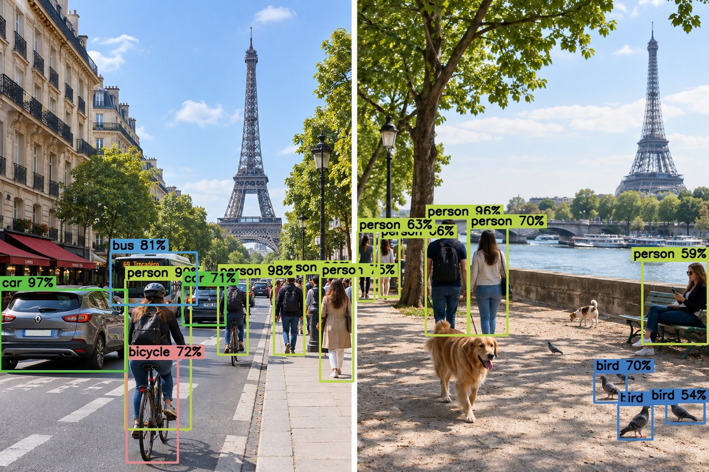
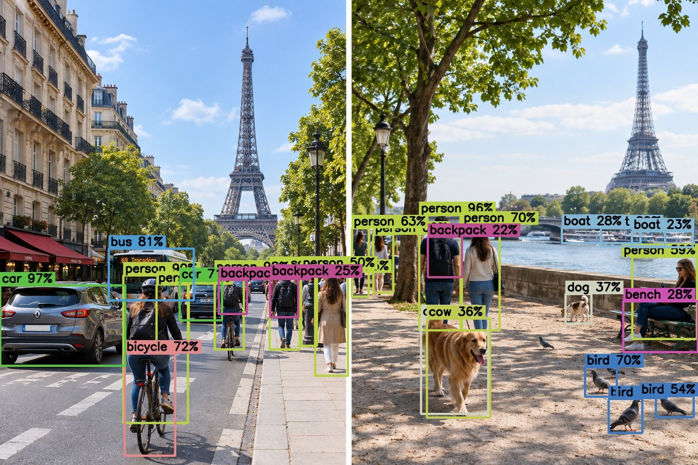

# Serving an Object-Detection Model with FastAPI

A hands-on lab in two notebooks that takes a pretrained object-detection model (**YOLO**) from "it works in my notebook" to "it is a web service anyone can call", and then writes a Python client that consumes that service.

You send the server a picture; it answers with the objects it found, either as JSON or as the same picture with boxes drawn on it.

## See it first

### Input: the unboxed picture

An AI-generated test image: two Paris scenes side by side, chosen because it packs many everyday object classes into one frame. The left half is a street (cars, a bus, cyclists, pedestrians); the right half is a riverside walk (people, two dogs, five pigeons, a bench, boats).


### Output: the boxed picture

The same image after a call to the API with default settings (`yolov4-tiny`, confidence `0.5`). The server found **16 objects**: 9 people, 2 cars, 1 bus, 1 bicycle and 3 birds.



Look closely at what is **missing**: the large golden retriever, the second dog, the bench and the boats are not detected. That gap is the hook of the lab, and the next picture shows one way to close it.

### Output: lower the confidence threshold

Same model, `confidence=0.2`. Now **28 objects** appear, including both dogs, the bench, the boats and some backpacks. The price: the retriever also gets a wrong `cow` box next to its correct `dog` box, and the busy street fills with overlapping boxes.



There is no universally right threshold; the lab shows how to choose one and why the API exposes it as a parameter.

## What you will learn

- Keep **model code** and **serving code** separate, so each can be tested on its own
- Expose a model through a REST API with **FastAPI**: endpoints, query parameters, file uploads, response schemas
- Validate input and report problems with the right **HTTP status codes** (413, 415, 422)
- Run a server from a notebook, explore its auto-generated docs, and stop it cleanly
- Consume the API with `requests`: GET and POST, multipart uploads, JSON and binary responses
- Build a small, reusable **client class** with sessions, timeouts and error handling
- Recognise classic serving pitfalls: blocking the event loop, reloading the model per request, trusting client input
- Read detector output critically: confidence thresholds, false alarms, missed objects, small-object resolution

## How the lab is organised

```text
  client.ipynb                               server.ipynb
 +----------------+   POST /predict/json    +--------------------------------+
 | Python         |  ---- image + params -> | FastAPI  ->  YOLO (OpenCV DNN) |
 | requests / curl|  <--- JSON or JPEG ---- | served by Uvicorn on port 8000 |
 +----------------+                         +--------------------------------+
```

| Notebook                       | Role                         | Main topics                                                                                                                                                         |
| ------------------------------ | ---------------------------- | ------------------------------------------------------------------------------------------------------------------------------------------------------------------- |
| [`server.ipynb`](server.ipynb) | **Part 1: build the server** | HTTP concepts, the model layer (develop and test detection offline), the API layer (FastAPI), running Uvicorn in a background thread, design notes, troubleshooting |
| [`client.ipynb`](client.ipynb) | **Part 2: build a client**   | anatomy of a request, raw GET and POST calls, a reusable client class, counting and filtering results, tiling, latency, error handling, `curl`                      |

Work through them in order. The server notebook leaves the API running, and the client notebook talks to it.

## Quick start

**Requirements:** Python 3.9+, Jupyter (JupyterLab or Notebook) and an internet connection for the one-time model download (about 25 MB).

```bash
python -m venv .venv
source .venv/bin/activate            # Windows: .venv\Scripts\activate
pip install jupyterlab
jupyter lab                          # start it from the folder that contains images/
```

1. Open `server.ipynb` and run all cells. A setup cell installs the dependencies (`fastapi`, `uvicorn`, `python-multipart`, `opencv-python-headless`, `numpy`, `requests`), and the model downloads on first use. The cell that stops the server is commented out on purpose.
2. Leave that notebook's kernel running, then open `client.ipynb` in a second tab and run all cells.
3. In a browser, open **http://127.0.0.1:8000/docs** for the interactive API documentation, and try the endpoints by hand.
4. When you are done, uncomment and run `stop_server()` at the end of `server.ipynb`.

The notebooks are shipped **without outputs**, so run them to see the results.

## The API at a glance

| Method | Path             | Purpose                           | Response                |
| ------ | ---------------- | --------------------------------- | ----------------------- |
| GET    | `/`              | health check                      | JSON                    |
| GET    | `/models`        | list selectable models            | JSON                    |
| POST   | `/predict/json`  | detect objects                    | JSON list of detections |
| POST   | `/predict/image` | detect objects and draw the boxes | JPEG image              |

Both prediction endpoints take an uploaded `file` plus optional query parameters `model` (`yolov4-tiny` or `yolov4`) and `confidence` (0 to 1, default 0.5).

```bash
# image in, JSON out
curl -X POST "http://127.0.0.1:8000/predict/json?model=yolov4-tiny&confidence=0.5" \
     -F "file=@images/paris_cars_people.png"

# image in, annotated image out
curl -X POST "http://127.0.0.1:8000/predict/image" \
     -F "file=@images/paris_cars_people.png" -o result.jpg
```

An abridged JSON response for the test image:

```json
{
  "model": "yolov4-tiny",
  "count": 16,
  "detections": [
    {"label": "person", "confidence": 0.9864, "box": [593, 594, 659, 769]},
    {"label": "person", "confidence": 0.9803, "box": [472, 602, 536, 769]}
  ]
}
```

`box` is `[x1, y1, x2, y2]` in pixels (top-left and bottom-right corners).

## What the test image teaches

All figures were measured in the lab's reference run (CPU, `yolov4-tiny` unless stated). Borderline detections can shift by one or two on other hardware.

| Experiment                       | What you observe                                     | Lesson                                                                             |
| -------------------------------- | ---------------------------------------------------- | ---------------------------------------------------------------------------------- |
| Confidence 0.8 → 0.5 → 0.3 → 0.2 | 7 → 16 → 20 → 28 objects                             | Lower thresholds find more, including more false alarms                            |
| Default threshold                | The golden retriever (44% confidence) is missed      | The right cut-off depends on the application                                       |
| Threshold 0.2                    | A `dog` box and a wrong `cow` box on the same animal | Duplicate suppression works within a class only                                    |
| Whole image vs the two scenes    | 16 objects vs 10 + 10 = 20                           | The network resizes inputs to 416 px, so smaller crops help small objects (tiling) |
| `yolov4-tiny` vs `yolov4`        | 16 vs 34 objects; the retriever found at about 99%   | A bigger model is more accurate and an order of magnitude or more slower on a CPU  |

## Models

Model files are downloaded at run time into `models/` and are not bundled with this repository.

| Name                    | Size         | Input     | Use                                                  |
| ----------------------- | ------------ | --------- | ---------------------------------------------------- |
| `yolov4-tiny` (default) | about 24 MB  | 416 × 416 | fast, good for demos                                 |
| `yolov4`                | about 250 MB | 608 × 608 | slower, more accurate; optional comparison in Part 2 |

Both detect the 80 [COCO](https://cocodataset.org/) classes and run through OpenCV's DNN module, so no TensorFlow or PyTorch is required. Adding a model means adding one entry to the `MODEL_SPECS` registry in `server.ipynb`.

## Repository layout

```text
.
├── README.md
├── server.ipynb                          # Part 1: the server
├── client.ipynb                          # Part 2: the client
├── images/
│   └── paris_cars_people.png             # test image (input)
├── images_predicted/
│   ├── paris_cars_people_boxed_conf0.5.jpg   # README illustrations
│   └── paris_cars_people_boxed_conf0.2.jpg
├── models/                               # created at first run: downloaded model files
├── scenes/                               # created by client.ipynb: the two cropped scenes
└── images_predicted/                     # created by client.ipynb: annotated results
```

If you publish this as a repository, ignore the generated folders:

```gitignore
models/
scenes/
images_predicted/
.ipynb_checkpoints/
```

## Using your own pictures

Set `TEST_IMAGE` (in the configuration cell of each notebook) to any JPG or PNG. Uploads are validated by decoding, are capped at 10 MB, and are processed in memory.

## Notes

- **Tested with** Python 3.12, OpenCV 4.13, FastAPI 0.143 and Uvicorn 0.54.
- **Local only by default.** The server binds to `127.0.0.1`, so only your machine can reach it. Change `HOST` only if you understand the exposure.
- **Licensing.** The test image is AI-generated and included for the lab. Model configuration and weights are fetched at run time from the [AlexeyAB/darknet](https://github.com/AlexeyAB/darknet) repository; check its terms before redistributing them. Add the licence for your own code here.
- **Troubleshooting** tables (port in use, missing `python-multipart`, slow first request, proxies, and more) are at the end of `server.ipynb`.
- **Examples** this lab is inspired by the original lab from the course Machine Learning in Production by Deeplearning (dot) ai
